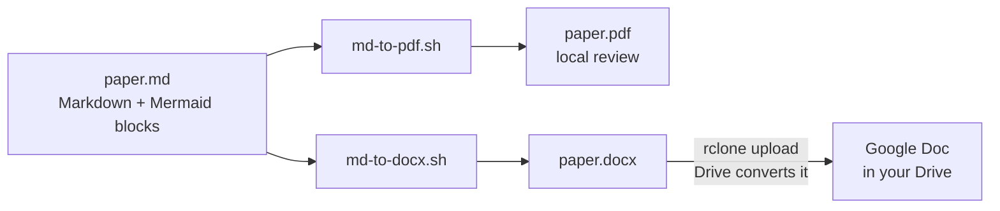
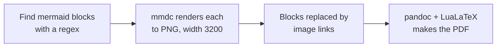
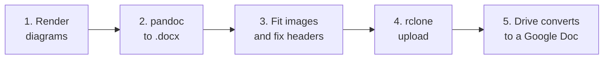
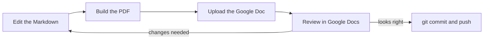

# What you will build {#sec-overview}

You write one Markdown file. A few commands turn it into two outputs:

- a **PDF** on your own disk, for quick local review, and
- a **native Google Doc** in your Google Drive, for sharing and commenting.

Diagrams are written as text (Mermaid) inside the Markdown, so they live in version control
next to the prose and are redrawn on every build. The Google Doc keeps the full image
resolution, a numbered table of contents, styled tables, and working cross-references.

This document is itself built with the pipeline it describes. The diagrams, the styled
tables and the cross-links you are looking at are the proof; [Check that it worked](#sec-proof)
lists what to check.



The Markdown file is the only thing you edit. Everything downstream is regenerated, so
never edit the Google Doc by hand if you intend to rebuild it: the next upload replaces it.

# What you need {#sec-prereqs}

| Tool | What it does here | Check it is installed |
|----------------|------------------------------------|----------------------------|
| pandoc | Converts Markdown to PDF and to .docx | `pandoc --version` |
| mermaid-cli (`mmdc`) | Renders Mermaid blocks to PNG; needs a headless Chromium | `mmdc --version` |
| python3 and python-lxml | Splits out diagrams; builds the Word template; fixes table headers | `python3 -c "import lxml"` |
| rclone | Uploads the .docx to Google Drive | `rclone version` |
| LuaLaTeX | The PDF engine | `lualatex --version` |
| JetBrains Mono Nerd Font | Monospace font for code blocks in the PDF | `fc-list \| grep -i JetBrainsMono` |
| LibreOffice (optional) | Renders the .docx to PDF locally as a rough visual check | `soffice --version` |

## Installing on Arch Linux {#sec-arch}

Most of the tools come from `pacman` (`pandoc`, `rclone`, `python-lxml` and the `texlive`
packages). `mmdc` comes from npm: `npm install -g @mermaid-js/mermaid-cli`.

## Installing on Ubuntu {#sec-ubuntu}

The package names below were checked against the apt index of Ubuntu 26.04 LTS. The
`mmdc` and font steps were not run end to end on Ubuntu, so treat them as the likely path
and expect to adjust.

Install the main tools in one line:

```
sudo apt update && sudo apt install -y pandoc python3-lxml rclone texlive-luatex texlive-latex-recommended texlive-latex-extra texlive-fonts-recommended lmodern fonts-jetbrains-mono nodejs npm
```

Optionally add LibreOffice, for local .docx checks:

```
sudo apt install -y libreoffice-writer
```

Install mermaid-cli into your home directory, so no `sudo` is needed, and make sure
`~/.local/bin` is on your `PATH`:

```
npm config set prefix ~/.local && npm install -g @mermaid-js/mermaid-cli
```

Test it on its own before building anything:

```
printf 'flowchart LR\n  A --> B\n' > /tmp/t.mmd && mmdc -i /tmp/t.mmd -o /tmp/t.png
```

Four Ubuntu-specific points:

- **rclone version.** Ubuntu 26.04's package is 1.60. This pipeline was built with 1.76. If
  the apt version misbehaves, install the current release from the rclone website (the
  "Install" page) instead, then continue with
  [Connect Google Drive](#sec-rclone).
- **The browser behind `mmdc`.** Installing mermaid-cli downloads its own headless Chrome,
  so you do not need the `chromium-browser` package. On Ubuntu that package is only a
  stub that installs a snap, which is a poor fit for command-line rendering.
- **Missing libraries or a blocked sandbox.** On a minimal install the browser can fail
  with "error while loading shared libraries": install the package named in the message
  (`libnss3` and `libgbm1` are common ones). Recent Ubuntu desktops can also restrict the
  user namespaces that Chrome's sandbox uses. Check with
  `sysctl kernel.apparmor_restrict_unprivileged_userns`: `0` means no restriction (the
  value on the Ubuntu 26.04 server used to check these steps), `1` means Chrome may refuse
  to start, and the fix is a Puppeteer config file passed to `mmdc` with `-p`.
- **The monospace font.** The PDF script asks for "JetBrainsMono Nerd Font", which apt does
  not provide. Either download the JetBrainsMono archive from the Nerd Fonts releases into
  `~/.local/share/fonts` and run `fc-cache -f`, or use the apt font by changing
  `monofont=JetBrainsMono Nerd Font` to `monofont=JetBrains Mono` in `scripts/pdf/md-to-pdf.sh`.

## Get the scripts {#sec-repo}

Everything the pipeline needs is in one repository: the build scripts, the Word template
and diagram theme, this tutorial, and the instruction files that let an AI assistant run
the pipeline for you.

```
git clone https://github.com/skeptomai/markdown-to-gdoc.git
cd markdown-to-gdoc
```

```
markdown-to-gdoc/
  README.md
  AGENTS.md                    rules for an AI coding agent working in this repo
  CLAUDE.md                    imports AGENTS.md for Claude Code
  .claude/skills/              ready-made /md-to-pdf and /md-to-gdoc skills
  docs/
    tutorial.md                this document, and the first thing you build
  scripts/
    pdf/
      md-to-pdf.sh             Markdown to PDF
    docx/
      md-to-docx.sh            Markdown to .docx, optionally uploaded to Drive
      docx-style/
        build-reference.py     builds the Word template
        diagram-config.json    Mermaid theme
        fit-images.py          caps image height
        inline-table-headers.py   keeps table headers legible in Google Docs
```

Run every command in this tutorial from the repository root. The scripts find their own
helper files relative to themselves, so the repository can live anywhere.

# Connect Google Drive with rclone {#sec-rclone}

This is a one-time setup. rclone talks to Drive with its own login, separate from any
chat-assistant connector.

1. Create the remote: `rclone config create gdrive drive scope=drive.file`
2. A browser window opens. Sign in and approve access.
3. Check it works: `rclone lsd gdrive:`

The `drive.file` scope means rclone can only see files it created itself. It cannot read or
change the rest of your Drive. That is a deliberate safety limit, and it has one
consequence: a different tool, such as an AI assistant's Drive connector, will not see the
documents rclone uploads, because it holds a different grant.

**Why not just use a Drive connector?** Connectors that upload files through a chat tool
can reject or truncate binary files above a few hundred kilobytes. A .docx with diagrams is
over a megabyte. Shrinking the images to fit loses fidelity, so this pipeline uploads with
rclone instead.

**One thing to fix soon.** Unless you supply your own OAuth client, rclone uses a shared
Google client ID that rclone has said it will retire during 2026. Every upload prints a
warning about it. When it stops working, uploads fail with an authentication error. The fix
is to create your own client in Google Cloud (Desktop app type, Drive API enabled) and run
`rclone config update gdrive client_id=<id> client_secret=<secret>`. The rclone
documentation page "Making your own client ID" walks through it.

# Write the Markdown {#sec-write}

Start the file with a YAML header. The title block, contents list and numbering come from
it:

```
---
title: "My Paper"
subtitle: "What it is about"
date: "2026-11-23"
toc: true
toc-depth: 1
numbersections: true
---
```

Then write ordinary Markdown. Four conventions matter for this pipeline.

**Diagrams.** A fenced code block whose language tag is `mermaid` (three backticks followed
by the word mermaid, then the diagram text, then three closing backticks) becomes an image.
The diagrams in this document are written that way. Look at the Markdown source of this file
to see one.

Quote every label, as in `A["Write"]`. Unquoted parentheses, colons and slashes break the
Mermaid parser. If a build fails on a diagram, test the block alone with
`mmdc -i diagram.mmd -o out.png`.

The scripts find diagrams with a regular expression, so they cannot show a *literal*
mermaid fence as an example: anything that looks like one is rendered. That is why this
section describes the fence in words instead of showing it.

**Anchors and links.** Give a heading an anchor with `{#sec-name}` and link to it with
`[text](#sec-name)`. For an appendix that should not be numbered, use `{-#app-name}`.

**Section numbers in prose.** The numbering is automatic, but a sentence like "see section
5.6" is hard-coded text. If you add or remove a top-level section, search for these and fix
them. Link with an anchor wherever you can.

**Table column widths.** In a pipe table, the number of dashes in the separator row sets
each column's relative width. Narrow separators produce narrow columns, and a bold header
label such as "KubeVirt" then wraps onto two lines. Size the dashes to the longest label:

```
| Check | Result |
|-------------------------|-----------|
```

# Build the PDF {#sec-pdf}

```
bash scripts/pdf/md-to-pdf.sh docs/paper.md
```

The script writes `docs/paper.pdf` next to the source. It has three steps.



The PDF is the quick review copy: it builds in seconds and needs no Google account. Open
it, read it, fix the Markdown, rebuild.

# Build the Google Doc {#sec-gdoc}

```
bash scripts/docx/md-to-docx.sh --gdrive gdrive: docs/paper.md /tmp/paper.docx
```

The first argument after the options is the Markdown file; the second is where the .docx is
written. Without `--gdrive gdrive:` the script stops after writing the .docx, which is
useful for a local look.



1. **Render diagrams.** Each Mermaid block becomes a PNG, drawn with the project diagram
   theme.
2. **pandoc to .docx.** pandoc builds the Word file using the styled template.
3. **Fit images and fix headers.** `fit-images.py` shrinks any image taller than a page,
   and `inline-table-headers.py` writes the header fill and colour onto each table cell.
4. **rclone upload.** `rclone copyto` sends the file with `--drive-import-formats docx`.
5. **Drive converts it** to a native Google Doc.

Two rules about the upload:

- **Keep the output filename the same on every run.** rclone replaces the existing file of
  that name, and Drive keeps converting it in place, so the link you shared keeps working. A
  new name creates a second document.
- **The name must end in `.docx`.** Otherwise Drive stores the file without converting it.

The script prints the uploaded name when it finishes. The converted document appears in
Drive without the `.docx` extension. Open it from Drive, or keep the link from the first
upload, which stays valid.

# How the styling works {#sec-style}

The look comes from four small pieces, all in `scripts/docx/docx-style/`:

| File | Purpose |
|----------------------------|----------------------------------------------------|
| `build-reference.py` | Builds the Word template: fonts, heading rules, table style, page layout |
| `diagram-config.json` | The Mermaid theme: colours and font for every diagram |
| `fit-images.py` | Shrinks any image taller than a page so it cannot overflow |
| `inline-table-headers.py` | Post-processing so table headers survive Google's import |

**Why `fit-images.py` exists.** pandoc scales every image to the page width. A tall, narrow
diagram, such as a top-to-bottom flowchart with several steps, then comes out far taller
than the page: one test diagram measured 6.5 by 17.7 inches. In the PDF it overflowed the
page and pushed the page number off it. The PDF script caps image height at 70 percent of
the text area, and `fit-images.py` does the same for the Word file. The better cure is
still to draw wide diagrams: use `flowchart LR` and short labels.

The template is rebuilt automatically if `nvidia-reference.docx` is missing. To restyle the
output, change the colours and fonts at the top of `build-reference.py`, delete the
`.docx` template and rebuild. Pass `--plain` to skip all styling and get pandoc's defaults.

**Why `inline-table-headers.py` exists.** The template makes table header text white through a
conditional rule on the table style ("first row"). Word applies that rule. Google's
importer keeps the black fill but drops the white text, so the headers come out black on
black. `inline-table-headers.py` writes the fill and the white bold colour directly onto
every header cell, which both Word and Google honour. If you ever restyle the headers, keep
that script in step with the template.

# The review loop {#sec-loop}



Commit only after you have looked at the Google rendering, because that is the copy other
people will read. The PDF is not enough: the local PDF engine and Google's importer render
tables and fonts differently, and some bugs (such as the black-on-black headers above) only
show up in Google.

# Working with an AI assistant on this {#sec-assistant}

This pipeline was built and run with Claude Code, and the same loop works with any coding
assistant that can run shell commands, such as Codex. What the assistant needs is small:

| Need | Detail |
|----------------------|------------------------------------------------------|
| Shell access | To run the two build scripts and `git` |
| A Drive login | Only the rclone remote you created, scoped to `drive.file` |
| No connector | The Drive connector is not used for uploads (see [Connect Google Drive](#sec-rclone)) |
| Guard rails | Ask-before-run rules for destructive rclone commands |

The repository ships its rules once, in `AGENTS.md`, the file that Codex and several other
agents read. `CLAUDE.md` imports it with a single `@AGENTS.md` line, plus a short note, because Claude Code
reads `CLAUDE.md` rather than `AGENTS.md`. Both agents therefore see the same instructions,
and you edit only one file. Two Claude Code skills, `/md-to-pdf` and `/md-to-gdoc`, are also
included. Other agents do not load them, but `AGENTS.md` describes the same commands.

Sensible guard rails: allow read-only listing and `rclone copyto` to your `gdrive:` remote,
and require confirmation for `delete`, `purge`, `sync`, `move`, `config`, and especially
`rclone link`, which creates a shareable public URL. Uploading a document to your own Drive
is private by default; sharing it should always be your decision.

Two habits keep the loop honest. Ask the assistant to say plainly what it did not check
(for example, "I did not look at the Google rendering"), and review the Google Doc yourself
before anything is committed.

# Troubleshooting {#sec-trouble}

| Symptom | Cause | Fix |
|------------------------|--------------------------------|--------------------------------|
| Table header bars are solid black | Header text colour was lost in Google's import | Make sure `inline-table-headers.py` ran; it prints a row count |
| A table header label wraps | Narrow column from a short separator row | Add dashes to that column's separator |
| A diagram fills a whole page, or the page number vanishes | A tall, narrow diagram scaled to page width | Redraw it left-to-right with short labels; the scripts also cap image height |
| Build fails at a diagram | Unquoted special characters in a label | Quote every label; test with `mmdc -i` |
| A code sample containing a mermaid fence renders as a picture | The scripts match fences with a regex | Describe the fence in prose, or change the tag in the sample |
| Upload creates a second doc | Output filename changed between runs | Reuse the exact same output filename |
| Upload stays a plain .docx | Name does not end in `.docx` | Fix the extension |
| Upload fails with an auth error | rclone's shared client ID was retired | Create your own OAuth client, see [Connect Google Drive](#sec-rclone) |
| Prose says "section 5.6" but it moved | Hard-coded number in the text | Search for and fix; prefer anchor links |
| PDF build fails on the font, or code blocks show missing glyphs | Nerd Font not installed | Install JetBrains Mono Nerd Font, or see [Installing on Ubuntu](#sec-ubuntu) |
| `mmdc` fails to launch its browser | Missing system libraries or a restricted sandbox | See [Installing on Ubuntu](#sec-ubuntu) |

# Check that it worked {#sec-proof}

This document makes claims, so here is how to test them. Open the Google Doc and check each
row.

| Check | What you should see | Result |
|---------------------|-----------------------------------------------|----------|
| Diagrams | Four flow diagrams, sharp when zoomed, none cropped | |
| Table headers | White bold text on a black bar, in every table | |
| Header labels | No wrapped labels, including the short ones in this table | |
| Numbering | Sections numbered 1 to 12 in the contents and headings | |
| Links | Clicking "Check that it worked" near the top jumps to this section | |
| Code blocks | Monospace, with the fenced text intact | |

Fill in the Result column yourself as you check. The build prints what it did (diagrams
rendered, header rows styled), but only you can see how Google renders the result.

If any row fails, the troubleshooting table above says where to look.

# Reference: commands at a glance {#sec-reference}

| Task | Command |
|---------------------|----------------------------------------------------------------|
| Build the PDF | `bash scripts/pdf/md-to-pdf.sh docs/paper.md` |
| Build the .docx only | `bash scripts/docx/md-to-docx.sh docs/paper.md /tmp/paper.docx` |
| Build and upload | `bash scripts/docx/md-to-docx.sh --gdrive gdrive: docs/paper.md /tmp/paper.docx` |
| Unstyled .docx | add `--plain` before the input file |
| Check the Drive remote | `rclone lsd gdrive:` |
| List what rclone uploaded | `rclone lsf gdrive:` |
